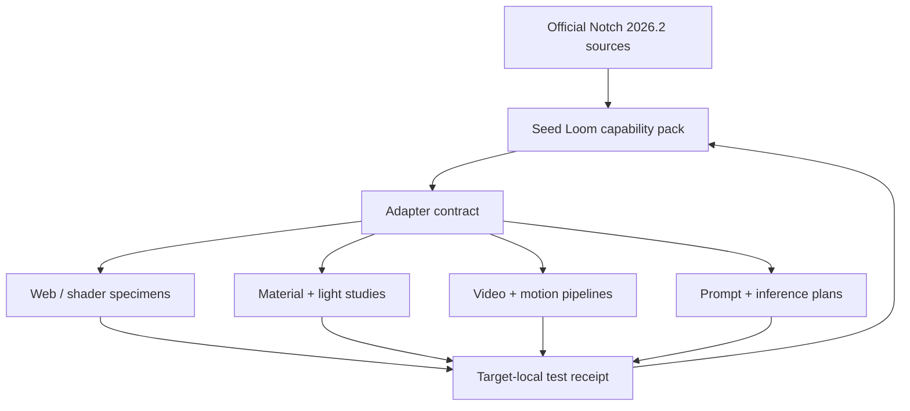
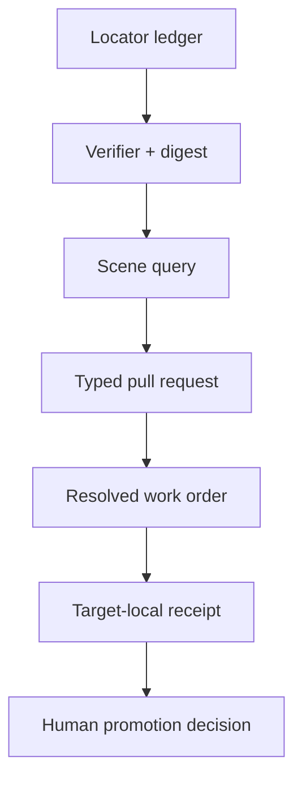

# Notch 2026.2 Capability Pack — Architecture and Application Plan

## Decision

Use one **source-backed capability pack** in Seed Loom as the semantic store for
Notch-derived mechanisms. Do not make Notch project files, `.dfxdll` blocks,
HLSL `.fx`, renderer-specific parameter values, videos, meshes, or generated
images the cross-repository source of truth.

The selected path is a small, deterministic pack with an explicit adapter
contract for each downstream domain. It is deliberately narrower than a
marketplace, general registry, vector service, or auto-publishing pipeline.

| Option | Benefit | Cost / risk | Decision |
|---|---|---|---|
| Store Notch files as the canonical library | Direct for a Notch-only team | Vendor/runtime locked; weak for web, shader, prompt, and UI targets | Rejected |
| Store screenshots, prompts, and tags | Fast discovery | Cannot reconstruct behavior or verify translation | Rejected |
| Semantic mechanism pack + target adapters | Preserves intent, constraints, traceability, and testability across systems | Requires authored target implementations | Chosen |

## System boundary



The feedback loop is source → reusable mechanism → bounded adaptation → target
evidence → refined constraint or warning. It creates compounding knowledge
without silently treating a beautiful render as evidence that the mechanism is
portable, accessible, fast, or licensed for every use.

## What the pack makes usable now

| User-facing domain | Pull from the pack | First target-local artifact |
|---|---|---|
| Image and video pipelines | `family:image-signal-composite`, `scene:inference-matte-loop` | composition manifest with color/alpha/frame-rate contract |
| Shader Grammar | `family:procedural-field`, `family:cellular-topology`, `family:material-light-intent` | grammar production + uniform contract + fallback statement |
| Shader Gallery | `scene:radial-field-bloom`, `scene:signal-garden`, `scene:optical-surface-ritual` | browser specimen manifest + accessible control panel |
| Material and light studies | `family:material-light-intent`, `scene:optical-surface-ritual` | material profile, lighting preset, two-angle comparison sheet |
| UI/UX physics and Canvas | `family:external-control`, `scene:signal-garden` | interaction state machine + reduced-motion state |
| Scenes, animation, and special effects | every `scene:*` recipe | timeline/shot specification plus first/last-frame and reset contract |
| 2D/3D objects, meshes, and overlays | `family:cellular-topology`, `family:surface-deformation` | mesh/texture manifest with topology and UV budgets |
| SVG Filter Lab | `family:image-signal-composite`, `scene:optical-surface-ritual` | filter candidate; intentionally not a GPU-simulation claim |
| Reverse prompt analysis and prompt engineering | all scene and family contracts | structured mechanism prompt, negative constraints, evaluation rubric |
| API inference layers | `family:ml-image-effect` | provider-neutral inference plan with model hash, rights, dimensions, latency target, and fallback |

## Application rules

### 1. Shader and rendering translation

Notch’s custom shader boundary is HLSL/D3DX `.fx`; a browser target may be GLSL
or WGSL. Translate the mechanism, not the source text. The target adapter must
name differences in coordinate system, precision, texture format, blend mode,
color space, lighting, and capability fallback. If those differences change the
result materially, record a `deviation` rather than offering theater-grade
equivalence.

### 2. Material studies

The canonical record is surface and lighting intent: base response, roughness,
metalness, transmission, normal/displacement character, light position,
camera angle, and expressive treatments. A renderer-specific map set is a
derivative. For iridescence, dispersion, glow, volumetrics, and thin-film
effects, mark whether the target is physically measured, physically inspired,
or purely expressive.

### 3. Interaction and control

Controls must expose the values a person can understand and safely change:
seed, amount, density, rate, response, palette, pause/reset, and quality mode.
Keep source signals (audio, camera, OSC, MIDI, pointer, tracking) separate from
their modulation mapping. A web or installation host gets explicit precedence,
defaults, ranges, smoothing, and reset semantics.

### 4. Prompt and inference use

The reverse prompt analyzer receives the **mechanism vocabulary**—for example
“feedback-bounded radial vector field rendered as colored density”—with facts,
inferences, negative constraints, and an evaluation plan. It does not receive a
claim that a prompt owns a style or that an output is reproducible across model
versions. Model weights and third-party input media stay outside this pack.

## Build order

1. Validate the capability pack and capture its digest.
2. Select **one** scene recipe and one adapter for a named target commit.
3. Create a target-local manifest that references the pack ID and digest.
4. Implement the smallest target-specific specimen; retain the declared
   fallback before adding higher-fidelity effects.
5. Run target-local compile, interaction/accessibility, visual, and performance
   checks.
6. Return the receipt. Only then may a reviewer mark the relevant adapter or
   family `reviewed`.

## Operational pull layer

The store is now executable as a narrow pull protocol rather than merely a
catalogue. `user-supplied-locator-ledger.json` retains all 128 unique official
Manual locators from the supplied node set (129 occurrences because the 3D
category was supplied twice); it stores URLs as the pinned 2026.2 nodes base
plus canonical relative paths and keeps no copied Manual content.



The commands are deterministic and do not write outside Seed Loom:

```sh
npm run capability:notch:verify
npm run capability:notch:query -- --scene scene:radial-field-bloom --adapter adapter:shader-gallery
npm run capability:notch:handoff
npm run capability:notch:test
```

The first work order is
`handoffs/shader-gallery-radial-field-bloom.request.json`. Its evidence-bound
target snapshot is `MelodicBloom/shader-gallery` `main` at
`93a0bd01aaefbed7094f803cfdf1134087302196`, observed on 2026-10-23, after the
Optical Studies repair had merged. It authorizes an original WebGL2 shader
specimen only after the receiver re-confirms that base. It deliberately maps
the Notch feedback concept to a stateless recurrence approximation: a
multi-pass temporal feedback runtime is an explicit non-goal, not a silent
degradation.

## First recommended proofs

| Priority | Bounded proof | Why it is first | Minimum evidence |
|---|---|---|---|
| P0 | `scene:radial-field-bloom` → Shader Gallery | Tests semantic field translation, controls, motion fallback, and gallery discovery in one small specimen | native shader compile, keyboard/reduced-motion check, fixed-seed still, supported-browser fallback |
| P1 | `scene:optical-surface-ritual` → Shader Grammar + material study | Tests renderer-neutral surface intent versus target-specific optical approximation | two-angle reference, input maps, shader compile, bloom-off comparison |
| P2 | `scene:signal-garden` → Canvas/UI simulation | Tests particle-performance degradation, interactivity, and human-legible controls | density tiers, reset, pause, keyboard/touch, frame-time trace |
| P3 | `scene:inference-matte-loop` → inference plan | Tests model provenance and failure-safe media treatment | model hash, input dimensions, sample rights, latency, missing-model fallback |

## Measures people often forget

- **Version matrix:** Notch version, target engine/browser, GPU/driver, color
  space, resolution, seed, and timebase must travel with every visual receipt.
- **Asset lineage:** record source, permitted use, modification status, and
  output rights separately from technical provenance.
- **Golden states:** capture a still, a short motion segment, and an
  interaction/reset state. A single hero frame cannot catch feedback drift.
- **Degradation contract:** define what reduces first—particle density,
  volumetrics, blur taps, resolution, or update rate—and preserve legibility.
- **Agent boundary:** an agent may propose a target change and produce a local
  receipt, but cannot promote, deploy, publish, buy API usage, or ingest
  restricted material without explicit authority.
- **Sunset path:** retain rejected effects, broken translations, and performance
  failures as linked evidence; do not delete them into a mist of revisionism.

## Definition of done for this intake

- Official source locators are pinned to Notch Manual 2026.2.
- The pack has unique source IDs, family IDs, scene IDs, and adapter IDs.
- Every family resolves to official sources; every scene resolves to existing
  families and adapters.
- Validation produces the same digest twice from unchanged inputs.
- The pack states what it cannot promise: no code mirroring, no cross-renderer
  equivalence, no automatic downstream mutation, no rights bypass.
- No downstream repository has been changed, promoted, deployed, or published
  by this intake alone.
